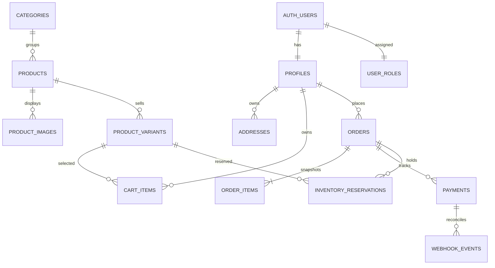

# Database and permissions plan

Status: local backend implementation prepared and tested with an isolated PostgreSQL cluster and mocked provider responses. It has not been deployed to Supabase/Xendit. This document explains the design; run the actual SQL files linked below, not this Markdown document.

Setup walkthrough: [Supabase and Xendit guide](SUPABASE_XENDIT_SETUP.md).

## Working defaults

- One store, customer/admin roles, Philippine addresses, and PHP currency.
- All prices/totals stored as integer centavos: PHP 150.00 = `15000`. Convert explicitly to the provider's required amount unit at the integration boundary; do not send the centavo value as a peso amount.
- Shipping is a server-controlled setting. PHP 150 is still only the preview example.
- Public catalog browsing; sign-in required for persistent cart, addresses, checkout, and order history.
- Reserve stock when an order is created for payment, consume it when payment is confirmed, and release it only after safe expiry/cancellation reconciliation.
- Proposed payment window: 30 minutes, synchronized with the provider's actual expiry. Confirm this when implementing.
- No customer cancellation/refund controls in the first demo. Closing the payment page leaves an order pending. Refunds and paid-order cancellation need a separate design if requested.

These are explicit planning defaults, not additional user-confirmed requirements.

## Payment integration choice

The local package implements Xendit test Payment Sessions, using a hosted one-time PAY payment with automatic capture and no saved payment method. The class's legacy invoice workflow is not implemented. Test-account access and channels still require hosted verification before claiming a working connection.

Current provider documentation distinguishes legacy `/v2/invoices` from `/sessions`, including different response fields and webhook events. Do not combine their payloads. [Xendit migration guide](https://docs.xendit.co/docs/migrate-to-payment-session).

Functions: `create-payment`, `xendit-webhook`, `reconcile-payments`, and the read-only `payment-return` page. `create-invoice` remains a class-reference name.

## Relationship map

Webhook events may arrive before a provider response has been saved, so their payment link can initially be null. Persist and reconcile authenticated unmatched events instead of losing them.

## Implemented tables

Use UUID primary keys except singleton settings and natural/compound keys where specified. Store timestamps as `timestamptz` in UTC. Add `created_at` and appropriate `updated_at` fields.

| Table | Main fields and constraints |
| --- | --- |
| `profiles` | `id` references Auth user, display name, optional phone. No password column. |
| `user_roles` | `user_id` primary key, role limited to `customer` or `admin`. Trusted provisioning only. |
| `categories` | Name, unique slug, active flag, sort order. |
| `products` | Category, name, unique slug, description, active flag. Archive products instead of deleting ordered catalog records. |
| `product_images` | Product, Storage object path, sort order. Store paths; generate the appropriate URL in the app. |
| `product_variants` | Product, unique SKU, option label (for example Size M), positive `price_minor`, `stock_on_hand`, `stock_reserved`, active flag. Enforce `0 <= stock_reserved <= stock_on_hand`. |
| `addresses` | Customer, recipient, phone, province, city, barangay, street/unit, postal code, optional instructions, default flag. At most one default address per customer. |
| `cart_items` | Customer, variant, positive quantity, revision number. Unique customer/variant pair; increment revision on changes. Selection can remain screen state. |
| `shop_settings` | Singleton currency, country, shipping fee, proposed reservation duration. Backend owns checkout values. |
| `orders` | Customer, unique human-readable order number, payment/fulfillment states, currency, subtotal/shipping/total in centavos, delivery snapshot, checkout source, expiry, idempotency key/request fingerprint. Unique customer/idempotency-key pair. |
| `order_items` | Order, optional original variant reference, immutable SKU/name/option/image-path snapshots, unit price, quantity, line total. Optional source cart row/revision for safe cleanup. |
| `payments` | Order, product type (`payment_session` or deliberately selected legacy invoice), unique merchant reference, nullable unique provider resource ID, optional successful underlying payment ID, hosted URL, expected amount/currency, provider status, local state, expiry. MVP allows one provider checkout resource per order. |
| `inventory_reservations` | Order, variant, quantity, held/committed/released state, expiry. Unique order/variant pair. |
| `webhook_events` | Unique deduplication key, event type, provider resource/reference, nullable payment, processing state, minimal normalized event data, timestamps. Backend-only inbox; do not retain unnecessary customer/card data. |

Keep orders and their snapshots when a saved address or catalog entry is edited. Define foreign-key delete behavior explicitly in migrations; avoid cascades that erase order history. Destructive account deletion is outside the initial app scope.

Important indexes: foreign keys, customer order history by creation date, customer cart/address ownership, product category/active state, provider references, pending-payment expiry, and unprocessed webhook events.

## Access rules

Enable RLS on exposed tables and grant only the operations each client needs. Restrict columns and function execution separately where required. RLS does not replace backend validation of totals or state transitions. [Supabase RLS](https://supabase.com/docs/guides/database/postgres/row-level-security).

| Data/operation | Guest | Signed-in customer | Admin UI | Trusted backend |
| --- | --- | --- | --- | --- |
| Active catalog/images | Read active published data | Read active published data | Read/manage catalog through authorized operations | Manage |
| Profiles | None | Read/update own allowed profile fields | No blanket access to unrelated profiles; necessary delivery data is on order snapshots | Manage when needed |
| Role assignments | None | Read own role | Read own role; no self-promotion or role grants | Owner/trusted provisioning only |
| Addresses | None | Own records only | No blanket customer address access | Validate ownership at checkout |
| Cart | None | Own records only | No blanket cart access | Validate and safely clean purchased source rows |
| Orders/items | None | Read own; no direct insert/update of totals/status | Read store orders; fulfillment updates through an authorized operation | Create and transition atomically |
| Payments | None | Read own safe payment summary/hosted URL; no writes | Read safe order-linked payment summaries | All mutations; keep internal fields out of client projections |
| Stock/reservations | Public availability only, no writes | Same | Change stock through guarded operation | Lock/reserve/commit/release |
| Webhook inbox | None | None | No direct access in initial admin UI | Receive, deduplicate, reconcile |
| Shop settings | Public projection only if needed | Public projection only | Update through authorized operation | Calculate checkout |

Catalog access must check active parent product/category as well as active variant, so archived catalog data does not leak through child-table policies. A public catalog projection should expose availability rather than internal reservation records.

Use backend-only transactional functions for stock changes, order creation, payment application, default-address changes, and fulfillment updates. Revoke default execution access where appropriate. If a helper uses `SECURITY DEFINER`, fix its search path and qualify object names; review grants and ownership explicitly.

## Role provisioning

1. Auth creates the user; a narrowly scoped signup trigger creates their profile and a default customer role.
2. Ignore client-supplied role metadata when assigning permissions.
3. The project owner promotes the intended admin by Auth user UUID using a specific SQL statement provided with the migration/setup package.
4. No customer-facing role editor exists. Admin operations verify current identity and trusted role on the backend.

## Transactional checkout

1. Flutter submits owned address ID, variant IDs/quantities or selected cart IDs, and a unique checkout idempotency key. Client prices are not authoritative.
2. Backend verifies identity and request ownership, merges duplicate variant selections, and locks variants in deterministic ID order.
3. Validate active catalog records and available stock: `stock_on_hand - stock_reserved`.
4. Calculate centavo totals using stored prices/settings, write order/item/address snapshots, and reserve stock in one database transaction.
5. Repeated idempotency key with the same request returns the existing order; a changed request with that key is rejected.
6. Call Xendit after committing the reservation transaction; do not hold database locks during an external network call.
7. Persist the returned provider resource ID, hosted URL, and expiry. Return only the owned order's safe checkout data.
8. If creation is definitively rejected and no provider payment exists, release the hold in a transaction. A timeout has an unknown outcome: reconcile before attempting another charge resource or releasing its stock.

Do not assume the provider enforces our idempotency key. Verify the selected API's duplicate/retrieval behavior and design recovery before implementation.

## Order/payment states

| Area | Implemented states |
| --- | --- |
| Order payment summary | `pending`, `paid`, `expired`, `cancelled`, `needs_review` |
| Payment operation | `reserved`, `creating`, `active`, `paid`, `expired`, `cancelled`, `creation_failed`, `unknown`, `needs_review` |
| Fulfillment | `unfulfilled`, `preparing`, `shipped`, `delivered` |
| Reservation | `held`, `committed`, `released` |

Successful payment moves the order to `paid` and fulfillment to `preparing`. An individual failed payment-method attempt must not automatically expire an otherwise active hosted checkout. For Payment Sessions, completion can mean different things depending on session/capture configuration: the implementation must validate our one-time PAY/automatic-capture flow and confirm successful payment evidence before marking paid. [Session lifecycle](https://docs.xendit.co/docs/payment-sessions-overview), [manual-capture distinction](https://docs.xendit.co/docs/authorization-and-capture-flow-manual-capture).

### Confirmed payment

- Verify callback token first, then expected merchant/business where present, resource/reference, amount/currency, flow type, and actual successful payment state.
- Persist a deduplicated event before acknowledgement, or complete the small state transition transaction before returning success. Return a retryable error if nothing was durably recorded.
- Lock affected order/reservations, apply payment once, decrement on-hand and reserved stock once, and mark holds committed.
- Delete purchased source cart rows only if their variant/quantity/revision still match checkout snapshots. Preserve newer edits. Buy Now never cleans the cart.
- Do not regress a paid order because an older expiry/failure event arrives later.
- If payment succeeds after stock was released or the event is inconsistent, record the evidence and flag `needs_review`; do not oversell or invent a completed fulfillment.

### Expiry and reconciliation

- Browser/app countdown is informational. A backend reconciliation job checks expiring or uncertain provider resources.
- Release stock only after confirmed nonpayable expiry/cancellation or a definitive creation failure. Uncertain resources stay held for reconciliation.
- Reconcile orphaned webhook events and provider-created resources whose response was not saved locally.
- An expired resource is not reused. A customer can start a new checkout with a new key after safe expiry handling.
- Proposed job frequency: every minute, in bounded batches. Verify supported scheduling and secure worker authentication before deployment.

Xendit documents repeated and potentially out-of-order webhook delivery; callback processing must be authenticated and idempotent. [Webhook handling](https://docs.xendit.co/docs/handling-webhooks).

## Storage

Implemented bucket: `product-images`, public catalog imagery with 5 MB JPEG/PNG/WebP limits. Authorized admins can upload new files; overwrite/delete remains owner-only in this initial package to preserve order-linked images. Never put addresses or credentials in this bucket. Use new unique paths for replacement images.

## Local implementation files

These files now exist locally. Follow the setup guide to deploy them; no account-level deployment has been performed.

| File | Purpose |
| --- | --- |
| `supabase/migrations/0001_schema.sql` | Tables, constraints, indexes, timestamps |
| `supabase/migrations/0002_permissions.sql` | Grants, RLS, role/profile bootstrap |
| `supabase/migrations/0003_business_functions.sql` | Transactional checkout, stock, addresses, payment transitions, fulfillment |
| `supabase/migrations/0004_storage.sql` | Bucket configuration and image policies |
| `supabase/seed.sql` | Clearly fictional school-demo catalog/settings |
| `supabase/functions/create-payment/index.ts` | Authenticated checkout and provider resource creation |
| `supabase/functions/xendit-webhook/index.ts` | Verified callback handling |
| `supabase/functions/reconcile-payments/index.ts` | Provider lookup, inbox retry, and safe expiry recovery |
| `supabase/functions/payment-return/index.ts` | Static public return page with no state changes |
| `supabase/setup/schedule-reconciliation.sql` | Hosted Cron setup using preconfigured Vault secrets |
| `supabase/setup/promote-admin.sql` | Owner-only admin promotion with explicit Auth user UUID |
| `scripts/build-dashboard-functions.mjs` | Generate self-contained files for the browser function editor |

## Acceptance checks before deployment

- Two customers cannot access each other's private records.
- Customer signup/profile edits cannot grant admin privileges.
- Direct client writes cannot forge order totals, payment, inventory, or fulfillment status.
- Concurrent last-item checkout cannot reserve stock twice.
- Repeated checkout request returns the same owned order/resource safely.
- Duplicate and out-of-order callbacks do not apply stock/payment effects twice.
- Unknown provider-creation outcomes reconcile before retry/release.
- Expiry releases only unpaid nonpayable reservations.
- Address/catalog edits preserve order snapshots.
- Buy Now preserves the cart; paid-cart cleanup preserves newer cart edits.
- Admin stock adjustments cannot reduce stock below held reservations.

Local checks are recorded in `PROJECT_STATUS.md`. Hosted Auth/Storage behavior, Edge compilation, Cron/Vault/pg_net setup, and an actual Xendit test checkout still need account-level verification. Recovery of an uncertain creation without a saved provider ID uses a matching provider session ID from the owner, or an explicit owner-confirmed no-resource resolution; it never blindly retries a charge.
