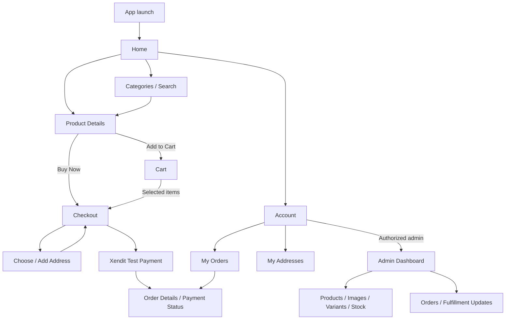

# Screen map and layout plan

Status: the accepted four-screen dark preview remains the visual baseline. Customer shopping/auth/payment/history and the shared-app admin panel are now locally implemented; see PROJECT_STATUS.md for user-reported versus tested checkpoints. This document retains the original layout proposal. Sample catalog/branding and final styling remain open.

Preview: [Open the shopping flow](previews/shopping-flow.html). Open the HTML file in a browser; no server, account, or installation is needed. The preview uses fictional products, prices, stock, addresses, and a sample shipping fee. It has no persistence or payment connection.

## Design direction

- Confirmed direction from the user: dark theme inspired by the Chrome Hearts catalog concept. Use black/charcoal surfaces, silver accents, light text, and subtle grey borders throughout Home, Product Details, Cart, Checkout, and dialogs.
- Preview tokens: page `#101012`, card `#1b1b1e`, primary text `#f2f0eb`, secondary text `#aaa8a3`, silver `#d9d6cf`, and borders `#373739`. Primary silver controls use dark text.
- Product photos take priority; the preview uses drawn placeholders until actual catalog images are selected.
- Gothic-inspired store/banner typography, serif section headings, and simple sans-serif controls. The offline preview uses locally installed display fonts with a Georgia fallback; the final Flutter font is undecided. Keep body text legible and primary touch controls around 48 logical pixels high.
- Keep total and primary actions visible near the bottom; scrollable content must not be hidden behind them.
- `CH / COLLECTION` is a preview label, not the confirmed app name.
- Use familiar ecommerce controls, with clear prices, selected variants, quantity, and delivery information.

## Proposed navigation

The diagram describes destinations. Add to Cart should show a confirmation and update the cart badge while keeping the customer on Product Details; View Cart opens the cart. Proposed authentication rule: browse publicly, then require login before saving cart items, addresses, or creating an order. Resume the intended action after login.

Proposed customer bottom navigation: Home, Categories, Cart, Account. Product Details and Checkout use back navigation and a dedicated action bar instead. Keep admin screens behind a role-authorized entry.

## 1. Home

| Order | Layout |
| --- | --- |
| 1 | Store label, collection subtitle, cart icon with badge |
| 2 | Search field with a clear search action |
| 3 | Featured collection banner with Browse Collection action |
| 4 | Horizontal category chips: All, Clothing, Jewelry, Accessories |
| 5 | Two-column product grid with image, category, name, and price |
| 6 | Customer bottom navigation |

Interactions: product opens Product Details; search/category filters the catalog; cart badge opens Cart. Retain scroll/search state when returning from details.

States: initial loading, catalog loaded, empty catalog, no search results, unavailable images, fetch error with Retry. No-results state offers Clear Filters.

## 2. Product Details

| Order | Layout |
| --- | --- |
| 1 | Back action, screen title, cart badge |
| 2 | Large product image/gallery |
| 3 | Category, product name, price, and availability |
| 4 | Required variant selector such as size; clearly mark selected/unavailable options |
| 5 | Quantity stepper and stock for the chosen variant |
| 6 | Description/material/condition details as applicable to the catalog |
| 7 | Fixed Add to Cart and Buy Now actions |

Require an available variant and quantity before either action. Quantity cannot be below one or exceed available stock. Display a useful message if stock changes during an action. A product without multiple options still maps to a sellable default variant in the future schema.

Add to Cart merges the same variant into the existing cart entry without silently exceeding stock. Show an Added to Cart message with a View Cart action. Buy Now starts checkout for this selection and preserves the cart. Disable duplicate submissions while saving/loading.

States: loading, missing product, image fallback, choose-a-variant prompt, out-of-stock variant, unavailable product, and save error with retry.

## 3. Cart

| Order | Layout |
| --- | --- |
| 1 | Back action, Cart title, line-item count |
| 2 | Select All and explanatory item-selection text |
| 3 | Each row: checkbox, image, product name, chosen variant, unit price, quantity, remove action |
| 4 | Estimated shipping note; exact summary appears in checkout |
| 5 | Fixed selected-items subtotal and Checkout action with selected quantity |

Only checked items go to checkout. Disable checkout when nothing is selected. Quantity and removal updates must persist to the signed-in account in the real app. Unselected items remain in the cart. Backend validation must catch price/stock changes before payment.

States: loading, empty cart with Continue Shopping, no selected items, unavailable variant, quantity update in progress, and update failure with recovery. Preserve selection when returning from checkout where possible.

## 4. Checkout

| Order | Layout |
| --- | --- |
| 1 | Back action and Checkout title |
| 2 | Delivery address card: recipient, phone, full address, Change/Add action |
| 3 | Order items: image, name, variant, quantity, and line total |
| 4 | Delivery option and shipping fee |
| 5 | Payment card: Continue with Xendit; actual payment methods come from the configured hosted payment flow |
| 6 | Subtotal, shipping, and total |
| 7 | Fixed total and Pay Now action |

Require a valid customer-owned delivery address and a backend-validated nonempty order. Show an Add Delivery Address action if none is saved; never silently invent an address. Explain any price/stock changes and ask the customer to review the updated order before proceeding.

Prevent duplicate order/payment creation while submitting. On payment-page return, fetch the order's backend state. A closed page or success URL is not proof of payment. Pending/expired states need clear next actions once the payment policy is finalized.

## Address selection and editor

From Checkout, open saved addresses with the current/default choice selected. Include Add New Address and Edit. Validate recipient, phone, province, city/municipality, barangay, street/building/unit, and postal code. Instructions are optional. Save and return to checkout without discarding the selected items.

The preview only switches between two fictional addresses to show the layout; an address editor is not included in this first visual pass.

## Offline preview behavior

- Four screen-switch buttons allow direct review of Home, Product Details, Cart, and Checkout.
- Search and category filters operate on three sample items.
- Product options and quantity, Add to Cart, Buy Now, cart selection/removal/quantity, and address selection operate only in browser memory.
- Buy Now preserves the preview cart. Reloading resets the preview.
- The sample shipping fee is PHP 150. It is a layout example, not a confirmed business rule.
- Pay Now opens a payment-handoff explanation. It creates no invoice and never marks an order paid.
- Account and full Categories screens, authentication, order history, and admin are mapped but not visually designed in this pass.

## Design acceptance checklist

- Product price, selected variant, quantity, and action are easy to identify.
- Add to Cart and Buy Now have distinct outcomes.
- Cart shows exactly which items will be checked out.
- Checkout shows the full delivery address and total before payment.
- Layout remains usable at narrow phone widths and with keyboard navigation in the browser preview.
- Loading, empty, validation, and error states are specified for Flutter implementation.
- Sample values are clearly distinguished from confirmed catalog/shipping data.

## Implemented customer visual pass

The Collection, Product details, Cart, Checkout, and Account screens now share neutral black
and silver colors, system-serif headings, bordered panels, consistent controls, and constrained
desktop content widths. Collection cards adapt from one to four columns and use uploaded
catalog photos. The homepage banner uses the four user-supplied photos from asset/img and
automatically advances every 5 seconds, with swipe/dots/arrows and pause/play controls.
Product image/details and checkout summary use side-by-side layouts on wide
screens; product actions stack on narrow screens or with larger text. Cart selection is highlighted
and checkout actions stay in bounded footer bars. Account links and identity/role are grouped
into panels. See [UI review](UI_REVIEW.md) for the actual Flutter screen checklist and limits.

## Current Flutter order tracking

My orders uses flexible dark cards showing the order number, total, payment status, delivery
stage for confirmed paid orders, and a readable local creation date/time. Order details shows
a vertical Preparing → Shipped → Delivered progress card for paid orders, with explicit
Completed, Current stage, and Upcoming labels. It reads the saved backend fulfillment state;
it does not estimate courier movement or invent tracking timestamps. Pending orders show
the saved payment deadline in local time. Passing the deadline still requires provider/worker
verification before the app can show Expired.

## Original preview milestone

The current dark layout is accepted. Prepare the database/schema and permissions plan, including stock reservation/expiry/cancellation rules, before implementing Flutter features. Incorporate any later user design feedback into this baseline.
