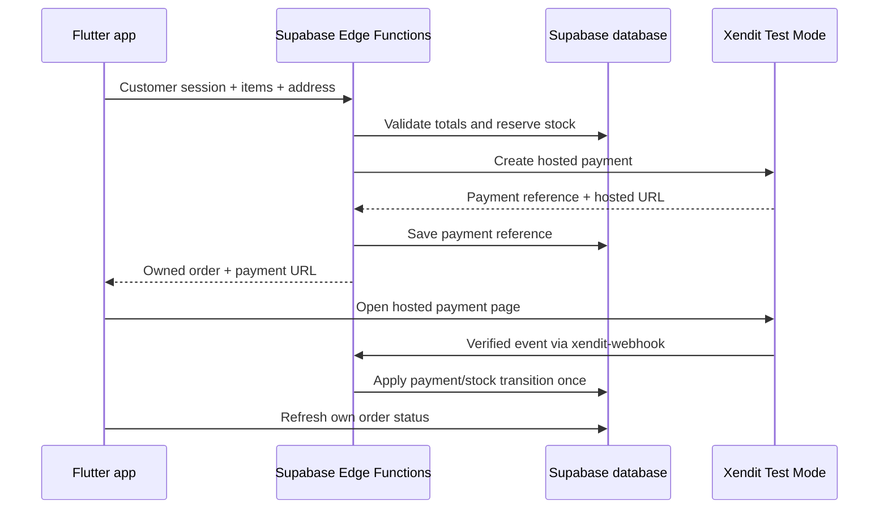

# Step-by-step: Supabase + Xendit

Guide date: 2026-10-25. Para ito sa school project natin at sarili mong Flutter app sa `ecommerce/`. Test payments ang target.

## Ano ang ready ngayon?

| Parte | Status |
| --- | --- |
| Screen layout | Accepted ang dark-theme preview |
| Database design | Implemented locally; rationale nasa [DATABASE_PLAN.md](DATABASE_PLAN.md) |
| Account/project setup instructions | Puwedeng sundan kung wala ka pang existing setup |
| SQL migrations, seed, Edge Function code | Available sa `supabase/`; passed local PostgreSQL and mocked-handler checks |
| Actual Supabase/Xendit connection | Hindi pa na-configure o na-test sa account mo |

May actual files na sa local repository. Ang migration ay `.sql` file na nagse-set up ng tables, permissions, o business logic. I-paste ang **laman ng file**, hindi filename. Walang na-upload sa account mo; ikaw ang magru-run sa dashboard gamit ang steps dito. Para sa unang activity lang, basahin ang [START_HERE.md](START_HERE.md).

Ang HTML sa `docs/previews/` ay design preview. Flutter ang app; Supabase ang database/Auth/Storage/backend. Hindi buong website ang ia-upload bilang SQL.

## Paano sila magkakabit?



Hindi database connection string ang ibibigay sa Xendit. Public HTTPS Edge Function URL ang webhook destination, at nasa backend ang secret key.

## Step 1 — Buksan o gumawa ng Supabase project

1. Pumunta sa [Supabase Dashboard](https://supabase.com/dashboard) at mag-sign in.
2. Kung may project ka na para sa app na ito, iyon ang buksan; huwag gumawa ng duplicate.
3. Kung wala, gumawa/pumili ng organization, tapos New Project.
4. Kung kailangan sundin ang class naming, gamitin ang organization na `BMC` at project na `BMC-ecom1`. Hindi nito pinapalitan ang pangalan ng local Flutter folder.
5. Piliin ang angkop na available plan/region, gumawa ng database password, at hintaying maging ready ang project. Itago ang password sa sarili mong password manager.

**Checkpoint:** nasa dashboard ka ng tamang project. Ang account/project creation ay gagawin mo sa dashboard; walang resources na ginawa ng guide na ito. [Supabase Flutter quickstart](https://supabase.com/docs/guides/getting-started/quickstarts/flutter).

## Step 2 — Kunin ang app connection values

1. Buksan ang project Connect dialog.
2. Kopyahin ang Project URL at publishable/client key para sa app configuration later.
3. Kung kailangan makita ang ibang keys, pumunta sa Settings → API Keys. Ang lumang handout ay gumagamit ng `anon` public key; current docs prefer the publishable key. Gamitin ang key/initialization parameter na tugma sa installed SDK.
4. Huwag gamitin ang secret/service-role key bilang Flutter client key.

**Checkpoint:** alam mo kung saan kukunin ang URL at client key. Huwag ipadala rito ang secret keys. [Supabase key types and locations](https://supabase.com/docs/guides/getting-started/api-keys).

## Step 3 — Ilagay ang database SQL

**Ready locally.** Gamitin sa intended project na wala pang conflicting ecommerce tables. Kung may existing tables/data na para sa app, ipasuri muna ang overlap bago mag-run; run-once ang migrations at walang destructive reset sa guide.

1. Buksan ang SQL Editor → New Query sa tamang project.
2. Buksan ang bawat local file, copy all, at i-paste ang SQL sa hiwalay na query, sa pagkakasunod:
   - [0001_schema.sql](../supabase/migrations/0001_schema.sql) — 14 tables, constraints, at closed-by-default access.
   - [0002_permissions.sql](../supabase/migrations/0002_permissions.sql) — customer/admin permissions at safe catalog/payment views.
   - [0003_business_functions.sql](../supabase/migrations/0003_business_functions.sql) — checkout, stock, payments, addresses, at fulfillment.
   - [0004_storage.sql](../supabase/migrations/0004_storage.sql) — product image bucket/policy.
   - [0005_checkout_quote.sql](../supabase/migrations/0005_checkout_quote.sql) — signed-in, read-only checkout review using server prices, shipping, stock, and owned addresses/cart. If 0001–0004 are already complete, run only this new file.
3. Run one migration at a time. Kapag may error, itigil muna ang susunod na file at itama ang exact error; huwag basta ulit-ulitin lahat sa existing database.
4. Run [seed.sql](../supabase/seed.sql) para sa fictional demo catalog. Sample shipping fee ay PHP 150, configurable sa `shop_settings.shipping_fee_minor` as `15000` centavos.
5. Run [setup/verify.sql](../supabase/setup/verify.sql). Isang result table ang lalabas: six checks, all with status `OK` for the unmodified seed. Counts: 14 tables, 14 with RLS enabled, 3 demo products, 7 variants, 1 configured `product-images` bucket, and 1 PHP/PH settings row. Isa sa variants ay zero stock.
6. Huwag i-run sa hosted project ang `supabase/tests/bootstrap.sql`; local mock Auth/Storage setup lang iyon.

**Checkpoint:** walang migration errors at nasa database ang tables, policies, functions, at sample data. Hindi sapat na may tables lang: kailangang subukan ang access bilang dalawang magkahiwalay na signed-in customers, dahil privileged ang SQL Editor. [RLS reference](https://supabase.com/docs/guides/database/postgres/row-level-security).

## Step 4 — Authentication, admin, at images

**After Step 3.**

1. Sa Authentication settings, ihanda ang email/password sign-in at email-confirmation behavior na gagamitin sa demo. Kapag required ang confirmation, kumpirmahin ang test email bago mag-login.
2. Habang wala pang app login UI, puwedeng gumawa ng test account sa Authentication → Users gamit ang dashboard Add User action kung available. Kapag implemented na ang app signup, subukan din ang tunay na customer registration flow.
3. I-check na may corresponding profile at default customer role.
4. Kopyahin ang intended admin account's Auth user UUID. Buksan ang [promote-admin.sql](../supabase/setup/promote-admin.sql), palitan ang zero UUID ng totoong ID, at Run sa SQL Editor. Hindi gagana ang unchanged placeholder.
5. Sa Storage, i-check ang `product-images` bucket. Upload JPEG/PNG/WebP files, up to 5 MB, under new unique paths. Admin uploads are allowed; overwrite/delete remains owner-only sa initial package para hindi mawala ang order-linked images. Seeded image rows are empty until actual photos are supplied.

**Checkpoint:** customer at admin roles are distinct, may sample images, at customer cannot grant admin access. [Storage bucket setup](https://supabase.com/docs/guides/storage/buckets/creating-buckets).

## Step 5 — Ihanda ang Xendit Test Mode

1. Mag-sign in o register sa [Xendit Dashboard](https://dashboard.xendit.co).
2. Piliin ang Test Mode/Development sa environment selector. Location ng selector can vary by dashboard version.
3. Settings → Developers/API Keys → Generate Secret Key.
4. Bigyan ng pangalan, halimbawa `bmc-school`, at Money-In/collection Write permission para sa required payment operations. Leave unrelated permissions, including payouts, disabled.
5. Complete the password/2FA prompt at kopyahin ang key once. A test secret normally starts with `xnd_development`.

**Checkpoint:** test key ang hawak mo, hindi live key. [Xendit API key instructions](https://help.xendit.co/hc/en-us/articles/16516398053273-What-is-API-Key-and-How-Do-I-Create-Them).

## Step 6 — Kunin ang webhook verification token

1. Sa Xendit, manatili sa Test Mode.
2. Settings → Webhooks.
3. Hanapin ang Webhook Verification Token, piliin ang View, at kumpletuhin ang authentication prompt.
4. Kopyahin ang token para sa Supabase backend secret. Huwag ihalo sa API key; magkaibang values sila.

**Checkpoint:** may test secret key at webhook token ka na. [Xendit webhook setup](https://help.xendit.co/hc/en-us/articles/360038048871-How-Do-I-Set-and-Update-The-Webhook-URL).

## Step 7 — I-save ang secrets sa Supabase

1. Buksan ang tamang Supabase project → Edge Functions → Secrets.
2. Idagdag at i-save ang tatlong entries:

| Name | Value |
| --- | --- |
| `XENDIT_SECRET_KEY` | Test secret key mula sa Xendit |
| `XENDIT_WEBHOOK_TOKEN` | Webhook verification token mula sa same Xendit environment |
| `RECONCILE_TOKEN` | Sarili mong long random worker token, at least 32 characters; generate in your password manager |

Dashboard-only alternative para sa worker token: sa SQL Editor, run `select gen_random_uuid()::text || gen_random_uuid()::text as reconcile_token;` at kopyahin ang result directly sa secret value. This generates a value without changing tables. Keep the value private; do not paste it into chat or repository files. Save the same value securely for the later Vault configuration.

3. Exact spelling ang gamitin. Function code reads these environment variables; wala silang hardcoded values sa source.
4. For Flutter Web later, add `APP_ORIGINS` as a comma-separated list of exact allowed browser origins. Native Android requests do not need an Origin. Unknown browser origins are rejected by default.
5. Supabase supplies its project URL/backend credentials to hosted functions. The code supports the default publishable/secret-key environment collections and the legacy anon/service-role environment values. Kung kulang ang runtime configuration, inspect function settings; huwag maglagay ng privileged key sa Flutter.

**Checkpoint:** nakalista ang secret names sa dashboard. Huwag i-log ang actual values o ilagay sa Flutter config. [Supabase Edge Function secrets](https://supabase.com/docs/guides/functions/secrets).

## Step 8 — Piliin ang tamang Xendit integration track

Implemented target: **Payment Sessions**, hosted one-time PAY flow with automatic capture, PHP/PH, and no saved payment method. I-verify na accessible ito sa test account mo bago mag-claim na connected na. Development keys lang ang tinatanggap ng code.

| Track | Creation function in our app | Hosted URL field | Webhook configuration |
| --- | --- | --- | --- |
| Implemented Payment Sessions | `create-payment` | `payment_link_url` | Payment Session Completed and Expired |
| Legacy class reference only; not implemented here | `create-invoice` | `invoice_url` | Invoice paid and expired |

Ang webhook handler sa guide ay `xendit-webhook` para sa napiling track. Hindi interchangeable ang event payloads at fields ng dalawang API. [Migration mapping](https://docs.xendit.co/docs/migrate-to-payment-session), [session creation](https://docs.xendit.co/apidocs/create-session).

## Step 9 — Deploy the Edge Functions

**Ready locally; requires your dashboard/account setup.**

1. Sa normal terminal, mula sa repository root, run:

```powershell
node scripts/build-dashboard-functions.mjs
```

2. Gagawa ito ng self-contained copies sa `supabase/dashboard/`. Generated files are ignored by Git; rerun the command after pulling source or changing handlers.
3. Sa Supabase, Edge Functions → Deploy a new function → Via Editor. For each row below, use the exact name, copy the **entire generated file**, Deploy, then apply the JWT setting:

| Deploy order / function | Generated file to paste | Enforce JWT Verification |
| --- | --- | --- |
| 1. `payment-return` | `supabase/dashboard/payment-return/index.ts` | OFF; public static page only |
| 2. `create-payment` | `supabase/dashboard/create-payment/index.ts` | ON; handler also validates real user session |
| 3. `xendit-webhook` | `supabase/dashboard/xendit-webhook/index.ts` | OFF; verifies `x-callback-token` |
| 4. `reconcile-payments` | `supabase/dashboard/reconcile-payments/index.ts` | OFF; verifies `x-reconcile-token` |

4. Save each function's settings. The short files under `supabase/functions/<name>/index.ts` import shared code; do not paste only those short wrappers into a one-file browser editor.
5. `create-payment` cannot be tested using a public key alone. It needs a real signed-in customer JWT. A 401 from an unauthenticated dashboard test does not justify disabling its protection.
6. Open `https://<project-ref>.supabase.co/functions/v1/payment-return?result=success` in a browser. Expected: a static page telling the customer to return to the order; it makes no payment claim or database changes.

**Checkpoint:** deployed ang exact function versions at alam ang URLs. [Dashboard deployment](https://supabase.com/docs/guides/functions/quickstart-dashboard), [function authentication](https://supabase.com/docs/guides/functions/auth).

## Step 10 — Ikabit ang Xendit webhook URL

**Requires deployed matching webhook code.**

1. Kopyahin ang deployed URL ng `xendit-webhook`:

```text
https://<project-ref>.supabase.co/functions/v1/xendit-webhook
```

2. Sa Xendit Test Mode → Settings → Webhooks, piliin ang events para sa track sa Step 8.
3. Configure Payment Session Completed and Payment Session Expired. Handler accepts `payment_session.completed` and `payment_session.expired`; other event types are ignored. Captured payment evidence is fetched from Xendit on the backend, so this package does not require a separate payment-status webhook destination.
4. Ilagay ang same HTTPS webhook URL sa relevant event destinations. Enable retries kung available.
5. Save and Test. Tingnan ang HTTP result at Supabase function logs. A sample test event may use a reference that does not correspond to a real order: verify transport/authentication separately, and do not force a customer order to paid just to pass a test.

For the built-in sample received during our setup (`data.id`, `session_type: SAVE`, `reference_id: test_session`), the updated handler should return HTTP 200 with `received: true`, `ignored: true`, and reason `UNSUPPORTED_SESSION_TYPE`. This is expected: our app creates PAY sessions, so no order/payment update is made for that sample. Another unrelated reference can return `UNRELATED_REFERENCE`.

If the old deployment returns `Invalid provider resource ID` for that sample, open Supabase → Edge Functions → `xendit-webhook` → Code, replace the code with the latest entire `supabase/dashboard/xendit-webhook/index.ts`, and Deploy updates. Keep JWT verification OFF. Retry both dashboard tests after deployment. This patch needs no SQL migration. Other generated handlers also include session-ID response compatibility; use the current bundles when updating their deployments.

**Checkpoint:** nakakarating ang matching test event. Hindi nito pinapatunayang gumagana na ang whole checkout. [Session webhook mapping](https://docs.xendit.co/docs/migrate-to-payment-session), [Xendit webhook behavior](https://docs.xendit.co/docs/handling-webhooks).

## Step 10B — I-schedule ang recovery/expiry worker

1. After deploying the worker, enable Cron/`pg_cron`, `pg_net`, and Vault using the Supabase dashboard's integrations/extensions pages if not already available.
   If Cron already shows Installed, leave it installed. The cleanup option manages job-run history; it is separate from enabling Cron. Continue to check `pg_net` instead of reinstalling the module.
2. Sa Vault, create exactly one secret named `bmc_project_url` with your project HTTPS URL.
3. Create `bmc_reconcile_token` with the **same value** as Edge Secret `RECONCILE_TOKEN`. Edge Secrets and Vault are separate stores; adding it to one does not add it to the other.
4. Run [schedule-reconciliation.sql](../supabase/setup/schedule-reconciliation.sql) in SQL Editor. It checks prerequisites and creates/updates the `bmc-reconcile-payments` job for every minute. No actual token is embedded in that source file.
5. Sa Cron Jobs, inspect job history. Also inspect the worker invocation/HTTP result: a successful SQL job can enqueue an HTTP request even if the Edge request later fails. Expected worker JSON has `processed`, `failed`, and `unresolved`.
6. If `unresolved` contains an order without a provider ID, follow [backend recovery](BACKEND_API.md#recovery-worker). Never retry charge creation blindly after a timeout.

**Checkpoint:** worker authentication and scheduled invocation are verified on the hosted account. Local tests do not emulate Vault/pg_net/Cron. [Scheduled Edge Functions](https://supabase.com/docs/guides/functions/schedule-functions).

## Step 11 — Ikabit ang Flutter app

**Shopping and payment UI implemented locally.** Supabase initialization, public configuration, dark catalog/details, login/register, persisted sessions, cart/addresses, Buy Now, checkout review, Place Order, order details/history, and an external Xendit test-page action exist in `ecommerce/`. Review requires migration 0005. Follow [Flutter checkpoints](FLUTTER_SETUP.md), then [payment setup/checkpoints](PAYMENT_TEST.md), including the current `create-payment`/worker bundles and exact `APP_ORIGINS` for Chrome. Actual PAY/provider behavior remains unverified; no additional SQL is needed for payment UI.

1. Gamitin ang existing `ecommerce/` app. Doon patakbuhin ang dependency commands na kasama sa implementation instructions; huwag mag-`flutter create` ulit.
2. Nasa `ecommerce/lib/config/app_config.dart` na ang user-supplied URL/public key; `supabase_flutter` is configured and initialized before the collection loads. Run `flutter pub get`, then `flutter run` from `ecommerce/`.
3. Add Android internet permission. HTTPS ang hosted services.
4. Login, fetch products, save a cart/address, at call `create-payment` using the customer's session.
5. Buksan ang returned hosted URL. The backend supplies its own deployed `payment-return` URLs. Huwag gamitin ang webhook URL bilang success-return page. The future app should intercept its matching return path or let the customer close the page, then refresh the existing order.
6. On payment-page return, refresh the order from Supabase; success navigation must not mark it paid.
7. For exact request/response payloads and RPCs, use [BACKEND_API.md](BACKEND_API.md). Reuse checkout keys safely on interrupted requests; the backend validates prices/ownership.

**Checkpoint:** order creation works with correct ownership and backend totals; expiry recovery is installed before claiming inventory handling complete. [Flutter connection](https://supabase.com/docs/guides/getting-started/quickstarts/flutter), [Cron setup](https://supabase.com/docs/guides/cron/quickstart).

## Step 12 — End-to-end test payment

1. Gamit ang customer account, pumili ng product/variant, quantity, at address.
2. Checkout: tingnan ang database order at expected total. Dapat pending pa.
3. Buksan ang hosted test page at sundin ang official test/simulation instructions para sa payment method na available sa account. Magkakaiba ang simulation per method; hindi natin ipapangakong pareho ang wallet/card test steps.
4. Sa Xendit, tingnan ang actual test payment resource/status at matching reference.
5. Sa Supabase function logs, tingnan kung verified at processed ang webhook, without logging secrets/customer data.
6. Sa app/database, tingnan ang matching paid order at one-time inventory update.
7. Ulitin ang callback delivery kung supported: walang dobleng bawas ng stock.
8. Test a separate unpaid checkout until expiry: dapat accurate ang status at safely released ang reservation.
9. Test Buy Now: preserved ang existing cart. Test two customers: isolated ang addresses/cart/orders.

**Checkpoint:** mark the connection working only after these account-level checks pass. A saved webhook URL, dashboard test, or closed payment page alone is not payment confirmation. [Test account capabilities](https://help.xendit.co/hc/en-us/articles/13440335901849-How-I-can-use-my-Xendit-account-while-waiting-for-activation-KYC-process).

## Common errors

| Symptom | Check |
| --- | --- |
| `create-payment` returns 401 | Signed-in session/JWT, correct project, deployed auth configuration |
| Webhook returns 401 before handler runs | External webhook JWT setting; keep token verification inside the handler |
| Webhook token rejected | Same Xendit environment, exact secret name/value, no copied spaces |
| Xendit rejects the API key | Test/live environment, enabled collection permissions, selected API access |
| Payment succeeded but app stays pending | Matching resource/reference, event type, callback logs, amount/currency, handler transaction/reconciliation |
| Tables look accessible in SQL Editor but app gets permission errors | Test RLS/grants with the intended signed-in user's session |
| App cannot connect in release | Project URL/key, initialization, Android internet permission, network access |
| Stock stays held after expiry | Provider terminal state, worker schedule/authentication, and job history |

Keep SQL and function source in the local repository even when deploying through the dashboard. Ikaw ang bahala sa Git commit/push, gaya ng napagkasunduan.
